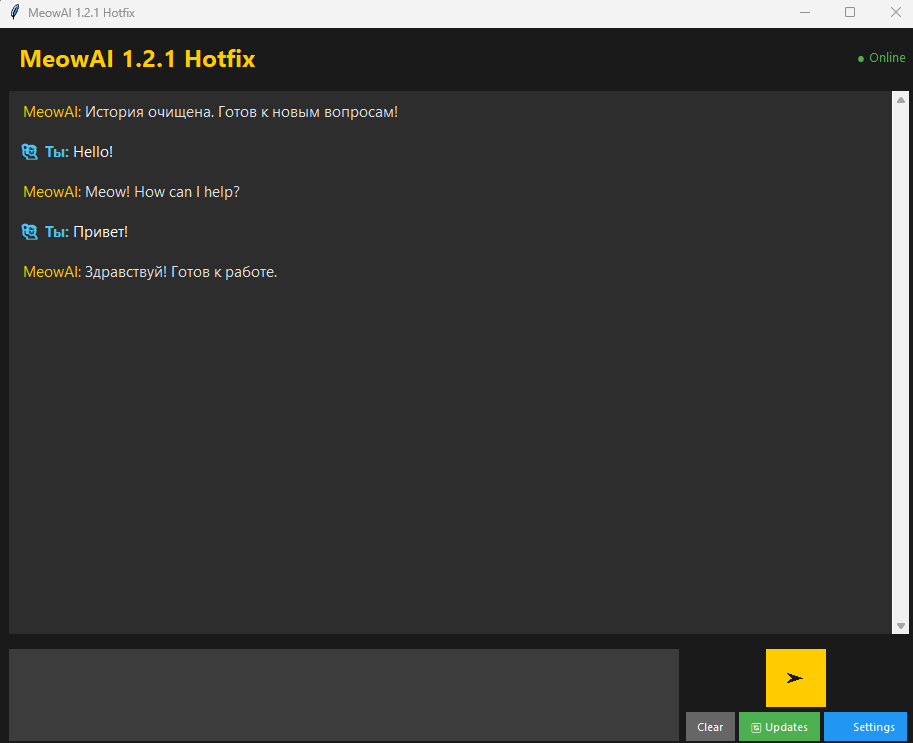

<!-- Иконки и виджеты -->

  
  
  
  
  

<h1 align="center">🐱 MeowAI v2.0.5 — Stable Core Edition</h1>

  <strong>Умный ИИ-помощник с характером. Безопасный поиск, мультиязычность и точные ответы без мусора.</strong>

  Разработчик: <b>matvey2222222222</b>

## 🌍 О функции смены языка

Функция переключения между RU и EN **стабилизирована** и работает корректно в большинстве сценариев. Настройки языка сохраняются и восстанавливаются при перезапуске.

Однако в редких случаях могут встречаться небольшие «сюрпризы»:
- История чата может частично отображаться на предыдущем языке.
- Контекстные ответы иногда требуют повторного запроса после смены языка.
- В отдельных ситуациях интерфейс может не обновиться мгновенно без перезапуска приложения.

Мы продолжаем работу над полной бесшовностью этой функции. Если вы заметили баг — пожалуйста, сообщите в Issues! 🐱

---

##  О проекте

**MeowAI** — это интеллектуальный десктопный ассистент с графическим интерфейсом. Он не просто копирует текст из интернета, а анализирует запрос, фильтрует рекламный шум, блокирует нежелательный контент и выделяет самую суть ответа. Программа сохраняет историю диалогов и найденные факты в локальную базу, чтобы при повторных вопросах отвечать мгновенно.

В версии **2.0.5** полностью переработана система проверки обновлений, улучшен «характер» ответов и повышена общая стабильность работы с сетью и файлами.

## ✨ Возможности версии 2.0.5

- **️ Фильтр безопасности 18+** — автоматическая блокировка ответов, содержащих эротический или порнографический контент, даже если он встречается в образовательных статьях.
- **🌍 Мультиязычность (Stable)** — полный перевод интерфейса, ответов бота и поисковых запросов. Поддержка русского и английского языков с сохранением настроек.
- **🧠 Умная нормализация** — понимает вопросы вроде «ИИ год создания» как запрос об истории искусственного интеллекта, а не о генерации изображений.
- ** Живой характер** — бот отвечает естественно, избегая шаблонных фраз. Поддерживает контекст беседы и помнит, о чем вы говорили ранее.
- **🧮 Встроенный калькулятор** — решает математические выражения мгновенно, не обращаясь к поисковикам.
- **🔍 Приоритет Википедии** — для исторических и фактологических запросов используется Википедия как основной источник, так как там текст чище и структурированнее.
- **🔄 Умная проверка обновлений** — корректно определяет статус релиза (Stable / Pre-release) и никогда не путает их местами.
- **⚙️ Меню настроек** — удобное модальное окно для управления языком и другими параметрами.
- **💾 Атомарная запись данных** — история и настройки сохраняются через временные файлы, что исключает их повреждение при внезапном закрытии программы.
- **🖥️ Стильный GUI** — темная тема, адаптивный интерфейс и удобная панель управления.
- ** Standalone приложение** — работает без установки Python. Всё необходимое уже упаковано внутри `.exe` файла.

## 🆕 Что нового в 2.0.5

- **Исправлена логика UpdateChecker**: теперь метод перебирает список релизов и возвращает первый, который новее текущей версии. Поле `prerelease` берется напрямую из GitHub API, что исключает ошибку, когда стабильный релиз помечался как тестовый.
- **Улучшен социальный интеллект**: добавлены более естественные варианты приветствий, благодарностей и фраз «думаю». Бот меньше похож на шаблонного ассистента.
- **Повышена отказоустойчивость сети**: все HTTP-запросы обернуты в `try/except` с таймаутами. Программа больше не зависает и не вылетает при потере интернета или недоступности API.
- **Безопасное сохранение файлов**: внедрена атомарная запись через `tempfile.mkstemp` + `shutil.move`. Даже если программа упадет во время записи JSON, файлы истории и настроек останутся целыми.
- **Оптимизирована нормализация запросов**: улучшена обработка стоп-слов для более точного поиска в базе знаний на обоих языках.

## ⚠️ Общие предупреждения

- Проект находится в стадии активной разработки. Несмотря на высокую стабильность ядра, возможны редкие ошибки.
- Всегда проверяйте критически важную информацию в первоисточниках.
- Автор не несет ответственности за любой ущерб, возникший в результате использования ПО.

## 📥 Скачать

Готовые сборки доступны в разделе **[Releases](https://github.com/matvey2222222222/MeowAI/releases)**.

## 📜 Лицензия

Проект распространяется под ПРИОПРИЕТАРНОЙ лицензией. Подробнее см. файл [LICENSE](LICENSE).
